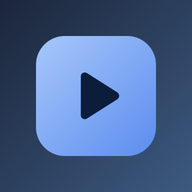
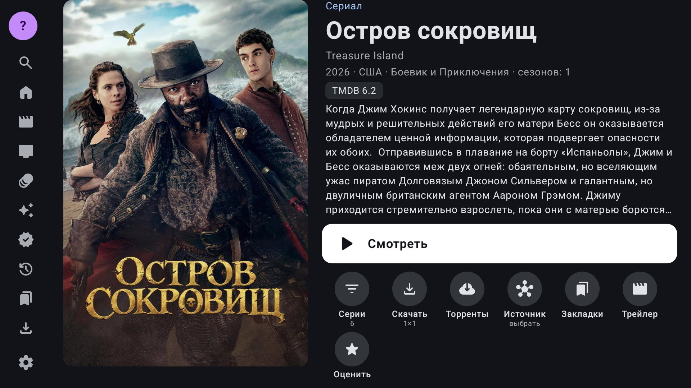
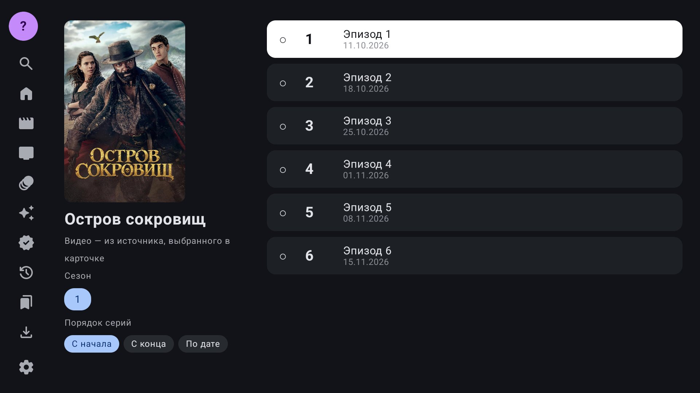

  
  

  

<h1 align="center">Решала ТВ</h1>

  <b>Фильмы, сериалы, мультфильмы и аниме на телевизоре — бесплатно и без рекламы</b> 
  Fixer TV · программа для Android TV и ТВ-приставок

  
  
  
  

  
  

  <a href="#-возможности">Возможности</a> •
  <a href="#-снимки-экрана">Снимки экрана</a> •
  <a href="#-установка">Установка</a> •
  <a href="#-поддержать-проект">Поддержать</a>

> [!NOTE]
> Первый выпуск готовится — кнопки «Скачать» заработают в день выпуска.

## 📺 О программе

**Решала ТВ** собирает кино из разных источников в одну удобную программу для телевизора. Каталог, поиск, серии,
озвучки и закладки — всё управляется пультом. Регистрация не нужна.

| | |
|---|---|
| **Совместимость** | Android 7.0 и новее — Android TV, Google TV, ТВ-приставки |
| **Архитектура** | `arm64-v8a` (64 бита) и `armeabi-v7a` (32 бита) |
| **Язык** | русский и английский |
| **Цена** | бесплатно, без рекламы, все возможности открыты всем |

## ✨ Возможности

- 🎬 **Каталог** — новинки, фильмы, сериалы, мультфильмы и аниме; фильтры и сортировка; постеры, описания и рейтинги.
- 🔎 **Поиск** по названию.
- 🔀 **Несколько источников видео** — видно качество и число озвучек; если видео не запускается, программа сама переходит к следующему источнику.
- 📂 **Сезоны, серии и озвучки** — сортировка серий, отметки просмотренного.
- ⏯️ **Досмотреть, Закладки, Обновления** — продолжить с того же места, свои папки закладок, новые серии ваших сериалов.
- ⬇️ **Загрузки** — скачать фильм или серию и смотреть без интернета.
- 🧲 **Торренты** — раздачи прямо в карточке фильма.
- 🧒 **Детский режим** с PIN-кодом и скрытие стран.
- 📱 **Веб-панель** — настройки с телефона в домашней сети.
- 💾 **Бэкап** истории, закладок и настроек — в папку или на флешку.
- 👥 **Несколько учётных записей**, у каждой свои настройки.
- 🔄 **Обновляется сама** — каждое обновление проверяется по подписи, подменить его нельзя.

## 🖼 Снимки экрана

  
  
  

## 📥 Установка

1. Выберите файл под приставку: **64 бита** — большинство современных приставок, **32 бита** — Mi Box, стики и старые модели.
   Не уверены — ставьте 64 бита; если Android ответит, что программа не подходит, берите 32 бита.
2. Перенесите файл на приставку любым удобным способом:
   - программой **Downloader** прямо на телевизоре;
   - с телефона программой **Send Files to TV**;
   - с флешки.
3. Откройте файл и разрешите установку из неизвестных источников, если Android спросит.
4. При первом запуске примите лицензионное соглашение — и можно смотреть.

**Обновления:** «Настройки → О программе → Обновление программы». Программа скачивает новую версию с этой страницы и
перед установкой проверяет подпись файла и контрольную сумму.

## ❤️ Поддержать проект

Программа бесплатная и останется такой. Если она вам пригодилась и хочется сказать спасибо — QR-коды кошельков есть
в самой программе: **«Настройки → Поддержать проект»**.

## ⚠️ Важно

Программа ничего не хранит и не размещает: она показывает то, что доступно на сторонних сайтах и сервисах. За содержимое
отвечают их владельцы. Полный текст лицензии — в программе: «Настройки → О программе → Лицензионное соглашение».

Постеры, описания и рейтинги — [TMDB](https://www.themoviedb.org/).
This product uses the TMDB API but is not endorsed or certified by TMDB.
