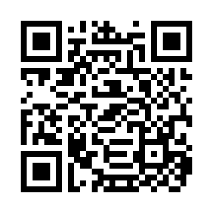

<p align="center"><a href="../../README.en.md#donate">← Back to the app page</a></p>

<h2 align="center">❤️ Support the project · USDT · Polygon network</h2>

<p align="center"></p>

<p align="center">Point your phone camera at the QR code to copy the wallet address.<br>Or copy the address manually:</p>

```
0x4e85cf9793001cfece9f404fa72132e5967fdaf5
```

> [!WARNING]
> Send **only USDT and only in the Polygon network**. A transfer in another network will not arrive.

The donation is voluntary: it unlocks nothing and changes nothing in the app — every feature is equally open to everyone.
